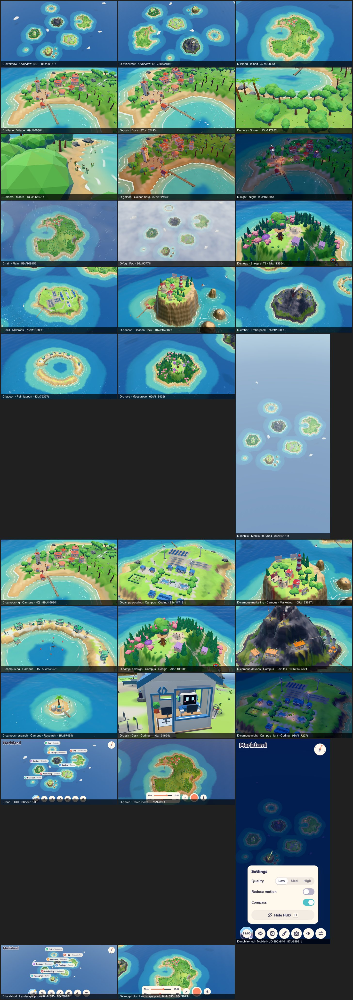

# Marisland

A cute, cozy, fully procedural 3D archipelago in the browser, built with three.js. Seven islands, one per department of an imaginary agent organisation, generated from a seed. Zoom in and the world blooms open, from island silhouettes down to crabs scuttling on the beach. Living boats, gulls, villagers, sheep, cats, dolphins and a whale, plus day/night cycles, weather and a relay of lights across the archipelago at night. **Everything (geometry, textures, creatures) is generated in code with three.js; there are no external assets beyond self-hosted fonts. Deterministic: the same seed URL always produces the exact same pixels.**

**Live demo:** https://omergungor11.github.io/marisland/



## Islands

Every seed has all seven department themes (D-024). HQ sits at the centre of the archipelago on every seed (D-058).

| Island (archetype) | Department | Culture |
|--------------------|------------|---------|
| Hearthholm | HQ | Harbour Guild |
| Mossgrove | Design | Glass & Light |
| Millbrook | Coding | Wind Gardens |
| Emberpeak | DevOps | Ember Smiths |
| Palmlagoon | QA | Inspectors |
| Beacon Rock | Marketing | Carnival Broadcasters |
| Lonely Palm | Research | Star Academy |

Three to six skerries and a sandbar islet fill the channels between them.

## Features

### World
- **Seven procedural islands** per seed, each shaped by its archetype: bluff coasts with earth walls, coves and harbours, lee terraces, cone-foot shelves and a terraced campus hill
- **Campus planners:** streets, lots, piers, landmarks and a themed kit per island (signage, lamps, movers, story spots)
- **Sea life of the map:** reef shoals, channel buoys along ferry routes, waterfalls off bluff lips
- **Coastal detail:** deep water, turquoise rings, foam bands, wet/dry sand, cliffs, black sand beaches

### Zoom detail ladder (4 tiers)
- **T0 (Map, 380–800 u):** Overview of all islands, cloud shadows, boat dots, labels
- **T1 (Island, 140–380 u):** Trees, cottages, docks, rocks, rowboats, real boats with ripples
- **T2 (Village, 45–140 u):** Bushes, fences, lanterns, villagers, sheep, crabs, workers at their desks
- **T3 (Macro, 12–45 u):** Ground cover within 60 u (grass tufts, flowers, shells, reeds, lily pads)

### Living creatures & NPCs
- **Sea:** Sailboats on routes with wakes, moored rowboats, gull flocks that perch, fish schools, jumping fish, dolphins, a grey whale that surfaces every 90–150 s
- **Land:** Villagers walking the path graph (they wave when you get close), workers on campus routes, sheep flocks, cats near the houses, crabs on the beach
- **Culture movers:** ferries on their routes, cranes, kites, bells and other per-island motion
- **Every instance has its own phase** (never in sync); clicking a tree, house or creature triggers a squash/hop/wobble reaction with a little particle burst

### Day/night, weather & night rituals
- **Time of day:** Dawn → Golden hour → Dusk → Night, with lerped lighting (warm sun, blue-violet shadows, cozy night luminance)
- **Night:** windows and lanterns switch on one by one, warm lantern pools on the ground, a sweeping lighthouse beam, moon with a glitter streak on the water
- **Relay:** signal lights pass from island to island between 18:30 and 06:30; fireworks burst over HQ harbour at 22:01
- **Constellations:** seven culture glyphs in the night sky above each island (21:00–04:00)
- **Weather:** Clear, cloudy, rainy (ripples on water), foggy (mist band near shore); weather cycles automatically or via UI
- **Sky:** Gradient dome with sun, moon, hashed stars; exponential fog that keeps far islands readable

### HUD & controls
- **Dock** (bottom): time dial (drag/scroll to scrub, tap to cycle the time stops), weather (clear → cloudy → rain → fog), new seed, tour (the camera flies a chain of wow framings; any input stops it, and it also starts by itself after 30 s idle), edit (sandbox, see below), photo mode (time + FOV 15–60° sliders, freeze, PNG export), settings (quality, reduce motion, compass, hide HUD)
- **Compass** (top-right): Reset camera to north
- **Island labels** (at T0): Click to fly to an island; auto-hide at closer zoom
- **Touch:** one finger pans, two fingers pinch-zoom and twist-rotate, double-tap an island to fly to it

### Performance & budgets
- **Quality tiers:** low (no post-processing), medium (bloom + grade + tilt-shift), high (MSAA + DOF); auto-picked, overridable in settings
- **Governor:** watches the rolling p90 frame time; steps the pixel ratio down first, then caps the detail tier, and upgrades at most once per session
- **Budgets:** per-quality caps on draw calls, triangles, shader programs and prop instance counts (`src/content/budgets.ts`); `pnpm shots --assert` fails if they are exceeded
- **Context-loss recovery:** the world is rebuilt from its seed when the WebGL context is lost and restored, keeping the camera pose

## Controls

| Action | Method |
|--------|--------|
| **Pan/rotate** | Mouse drag or touch pan |
| **Zoom** | Mouse wheel or pinch |
| **Fly to island** | Double-click island at T0 |
| **Toggle HUD** | Press `h` |
| **Exit photo mode** | Press `Esc` |
| **Click reactions** | Click buildings, trees, creatures |
| **Compass reset** | Click compass icon (top-right) |
| **Edit (sandbox)** | Press `e` or the brush button; `Esc` / Done to leave |
| **Undo / redo edits** | `Ctrl/⌘+Z` / `Shift+Ctrl/⌘+Z` (or `Ctrl+Y`) |
| **Brush size** | `[` / `]` |

## Sandbox

Press **`e`** or the **brush** button in the dock: the dock folds into the edit panel (a card at the bottom on desktop, a bottom sheet on phones, a side sheet on landscape phones).

- **Tools:** Raise · Lower · Flatten · Smooth (terrain brushes with size and strength; lower below sea level and the land floods) · Paint (grass, meadow, forest, sand, rock) · Place (pick a prop from the thumbnail grid; the ghost turns red where it cannot go) · Erase (tap a prop) · Move (drag a prop). Tap the active tool again to put it down and look around.
- **Mouse:** left-drag paints with the active tool; right-drag orbits, middle-drag pans, the wheel zooms. **Touch:** one finger paints, two fingers pan / pinch / twist.
- **Undo / redo:** the arrows in the panel or `Ctrl/⌘+Z`, `Shift+Ctrl/⌘+Z`; a whole drag is one step.
- **Share:** the link button copies the current URL with `edit=<log>` (a compact, versioned edit log). Opening it on any machine replays the same edits on the same seed. **Reset** (tap twice) restores the generated world.
- **Autosave:** edits are saved per seed in `localStorage` (`marisland.edit.<seed>.v1`) half a second after each change and restored on the next visit, unless the URL carries its own `edit=`.
- While editing, the idle orbit and the intro stop and the quality governor holds, so the detail under the brush never steps.

## URL Parameters

Query parameters control the view and capture mode. Example: `?seed=1001&time=17:30&quality=high&hud=1`

| Name | Values | Default | What it does |
|------|--------|---------|--------------|
| `seed` | 0–4294967295 | 1001 | Island layout seed (deterministic) |
| `shot` | named preset or `''` | `''` | Capture preset (wow, dev, ladder; see `src/content/shots.ts`) |
| `cam` | overview, island:*name*, village, dock, … or `x,y,z,tx,ty,tz` | `''` | Camera position preset or raw coordinates |
| `time` | 0–24, or HH:MM | — | Game time of day |
| `weather` | clear, cloudy, rain, fog | `''` | Weather state |
| `quality` | low, medium, high | `''` | Render quality (`''` = auto via governor) |
| `hud` | 1 or 0 | 1 | Show HUD (0 = hide) |
| `edit` | encoded edit log | `''` | Sandbox edits replayed on `seed` before the first frame |
| `panel` | photo, settings, edit, edit:*tool* | `''` | Open that HUD panel at boot (for screenshots) |
| `tour` | 1 or 0 | — | `1` starts the tour at once; `0` disables its idle auto-start |
| `freeze` | 1 or 0 | 0 | Capture mode (no intro, no governor; RAF stops when ready) |

Capture and debug flags (`freeze`, `shot`, `simt`, `panel`, `debug`, `perf`, `selftest`) are documented in `src/core/params.ts`.

## Getting started

### Requirements
- Node.js ≥ 22.12
- pnpm ≥ 10.28.0

### Install and run
```bash
pnpm install

# Development server (http://localhost:5173)
pnpm dev

# Build and preview (VITE_BASE=/marisland/ is set for GitHub Pages)
pnpm build && pnpm preview

# Type check, lint and test
pnpm typecheck && pnpm lint && pnpm test

# Deterministic headless screenshots (Playwright)
pnpm shots [ci|dev|wow|edit|ladder] [--assert] [--tag=<name>] [--port=<port>] [--no-selftest]
  # ci:     4 shots, 640×360, low quality (PR checks)
  # dev:    dev shots, 960×540 (milestone review; HUD and phone layouts)
  # wow:    hero presets, 1920×1080, medium quality
  # edit:   sandbox edits + the edit panel on desktop and phones
  # ladder: the zoom ladder per island (metric checks against the tier boundaries)
  # --assert: fail if budgets are exceeded
  # --tag=<name>: parallel run (isolates dist-<name>/ and shots/<set>-<name>/)
  # --port=<port>: preview server port (use a unique one per parallel run)
  # --no-selftest: skip the regen / context-loss self-tests
```

## Project structure

```
src/
  core/          Clock, frame loop, RNG (label-fork), noise, scope/dispose, params, quality tiers
  world/         Deterministic world data (no three.js imports; runs in Node/Worker)
  content/       ART_BIBLE tables → config (palette, archetypes, islands, themes/, cultures/, budgets, shots)
  geo/           Procedural mesh builders (bevelled, faceted, vertex-coloured, LOD variants)
  render/        Backend, materials, shaders, terrain/water/sky/clouds, prop batcher, shadows, post
  detail/        Zoom-tier FSM, fade/pop scheduler, LOD swaps
  life/          Agents: boats, ferries, villagers, workers, critters, gulls, fish, sheep, cats, dolphins, whale
  anim/, env/    Animation catalog, environmental state (time, weather, lighting)
  camera/        Camera controls, presets, pitch curve
  interact/      Click picking and creature reactions
  edit/          Sandbox: edit session (undo/redo, autosave, share), tools, brush cursor, ghost
  ui/            HUD, photo mode, settings panel, sandbox edit panel, theme icons
  capture/       Deterministic screenshot harness
  debug/         Stats overlay and dev tools

scripts/
  shots.ts       Playwright headless capture harness + contact-sheet generator

mar-docs/        Docs, screenshots and contact sheets (shots/)
mar-plans/       Build prompt, architecture, world master plan
mar-tasks/       Task index and phase details
mar-config/      Tech stack and coding conventions
```

**Docs:**
- [`mar-plans/ARCHITECTURE.md`](mar-plans/ARCHITECTURE.md): how the engine is built
- [`mar-plans/WORLD_PLAN.md`](mar-plans/WORLD_PLAN.md): world, island and roadmap plan (§5 is the milestone table)
- [`mar-docs/ART_BIBLE.md`](mar-docs/ART_BIBLE.md): what it looks like (palette, style, creatures, animations)
- [`mar-docs/VISUAL_QA.md`](mar-docs/VISUAL_QA.md): screenshot acceptance criteria
- [`mar-docs/DECISIONS.md`](mar-docs/DECISIONS.md): architectural decisions with dates and rationale (newest first)
- [`mar-docs/MEMORY.md`](mar-docs/MEMORY.md): project gotchas and patterns
- [`mar-tasks/task-index.md`](mar-tasks/task-index.md): task board (phases, milestones, status)

## Tech stack

**Runtime:** Node ≥ 22.12, pnpm ≥ 10.28.0

**App:** three.js r186 (WebGL2) · camera-controls · pmndrs postprocessing (bloom, tilt-shift, DOF, SMAA/FXAA) · simplex-noise · @fontsource fonts (Fredoka, Nunito)

**Tooling:** Vite 8 · TypeScript 6 (strict) · ESLint 10 (determinism rules) · Prettier · Vitest 5

**Testing & capture:** Playwright 1.56 (headless Chromium + SwiftShader for deterministic screenshots) · pixelmatch · sharp

**Hosting:** GitHub Pages, deployed on push to `main`

## Status

**Shipped (completed milestones):**
- **Phase 1, living diorama (M1–M10):** terrain, water, sky, vegetation, settlements, zoom ladder, sea and land life, day/night, weather, camera, HUD, photo mode, governor (the 10-seed sweep, TASK-192, is still in review)
- **Phase 2, sandbox (M11–M13):** terrain brushes, zone paint, prop place / erase / move, undo / redo, autosave, share links, edit panel
- **Phase 3, agent islands (M14, M14b, M14c):** seven themed campuses with working bots, theme-owned islands, living close-up activity
- **Concept Archipelago (M17b):** bluff coasts, earth walls, postcard pose, hero landmarks, waterfalls, Research / QA / Marketing / DevOps reworks
- **Seven Cultures (M19, M19b):** a culture kit, placement, movers and bot culture per island, plus the culture clock
- **HQ Seven Gates + Design Conservatory (M20):** HQ street plan with gates and the semaphore tower, Design conservatory and glasshouses
- **World P1 and five-island quick wins (M21, M22):** sky and sea shader pass, tour mode, channel buoys, quick wins per island (props, worldgen)
- **World signature (M23):** reef shoals, grey whale, relay night scene, culture constellations, night effects polish

**Roadmap:**
- **M24 Coding + QA signature (in progress):** Kite Hill and Wind Tunnel with Kite Day (Coding), Proving Grounds and a Figure-8 crash track (QA), then shots + QA
- **M25 / M26 DevOps I–II:** Emberpeak enlargement, funicular and ore cableway, summit bell, geyser field, onsen town and smiths' lane; then lava river, lava fall, ember bridge, crater deck, obsidian beach and breakwater. Props and anchors are in progress (TASK-503 … 506); placement and motion (TASK-507, 509) are still TODO
- **M29 HQ marina:** yacht marina with comb piers and 15–20 moored boats, breakwater, cove-mouth star fort with harbour lights (D-081)
- **M30 QA customs port:** scanner arch, cargo ship route under the arch, quay crane, inspection line, quarantine pontoons (D-082)

Marketing and Research signature moves are planned in `mar-plans/WORLD_PLAN.md` §5. The graphics passes M15–M18 (fine terrain LOD, decor, SSAO, water reflections) are not started, so they are not listed as shipped.
